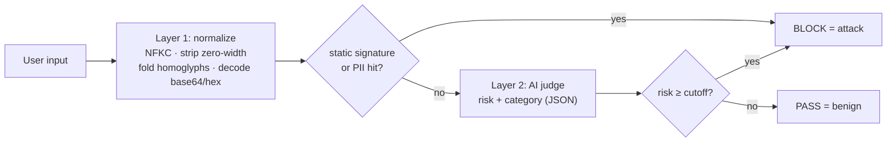
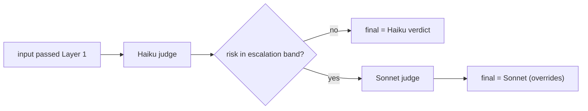

# I built a prompt-injection detector. The hard part was trusting the number.

*Label noise cuts both ways: a case study in measuring an LLM firewall honestly for under $1.*

## TL;DR

I built a small layered detector for prompt-injection and jailbreak attempts, then
spent most of my effort on one question: **can I trust the accuracy number I'm
about to put on it?**

The answer turned out to be the interesting part. Public prompt-injection and
jailbreak datasets are **mislabeled in opposite directions** — one hides real
recall, the other hides real false positives — so a metric computed naively
against either is misleading. Only after building a small, rubric-relabeled "gold"
set — and spot-checking it by hand — did I get a number I'd defend.

The arc, in one line:

> Self-authored tests said **100%** (and meant nothing) → first real dataset read
> **48 → 60%** detection → a second dataset exposed a **34.7%** false-positive rate
> I'd been about to dismiss → on a gold set, the stronger judge reached **88.9%
> detection / 3.1% false positives**, and a Haiku→Sonnet cascade matched it while
> escalating only **20% of cases** to Sonnet (band chosen on that set — held-out
> confirmation pending). Total: **$0.90 of a $80 budget**.

Those waypoints span different datasets and stages — that's the point, not a single
before/after. This write-up is about how I got from the meaningless 100% to a
number I'd sign.

Models used: `claude-haiku-5-5` and `claude-sonnet-5-5`. Everything is reproducible
from the repo; datasets are Apache-2.0 and MIT.

*A note on authorship: I ran this with heavy use of an AI coding assistant — it
wrote the harness and produced the first-pass gold labels under my direction, while
I made the design and go/no-go calls and did the human review. For an AI-security
write-up, that collaboration belongs in the honest record, not hidden from it.*

---

## 1. Why I made measurement the project

Prompt injection is not a niche concern. It sits at **LLM01 — the #1 risk in the
[OWASP Top 10 for LLM Applications (2025 edition)](https://genai.owasp.org/llm-top-10/)**,
where an attacker manipulates a trusted model through crafted input, directly or by
smuggling instructions through content the model ingests.

Building a detector for it is easy to start and easy to fool yourself about. A
regex and a model call will "work" on examples you wrote. The hard, and more
valuable, skill is producing a number that survives contact with data you didn't
author — and being honest about its confidence interval. So I treated the detector
as the means and the **measurement harness** as the deliverable.

---

## 2. The detector, in one page

Three layers, cheapest first. The design is deliberately ordinary; the rigor is in
how it's evaluated.



- **Layer 1 (free, offline):** Unicode NFKC, zero-width removal, homoglyph folding,
  and base64/hex decoding *before* matching, so the cheap evasions don't slip past a
  naive regex. Then high-precision signatures and PII patterns.
- **Layer 2 (AI judge):** a model call that returns a strict JSON verdict
  (`risk`, `category`, `confidence`, `reasoning`). A verdict at or above a chosen
  risk cutoff counts as an attack.
- **Layer 3 (later):** a cascade that escalates only uncertain cases to a stronger
  model — covered in §8.

Everything below is about whether the thing actually works.

---

## 3. The trap: it scored 100% on data I wrote

My first test set was 18 hand-written cases. The detector caught every attack and
flagged zero benign inputs: 100% detection, 0% false positives.

That number is worthless, and recognizing why is the whole discipline. **You can
always pass a test you wrote.** The 18 cases encode exactly the attacks I already
knew how to catch and the benign phrasings I already knew to allow. A perfect score
there proves the pipeline runs — not that the detector is good.

So the seed set earned one job only: a free, offline smoke test. The real question
needed data I hadn't touched.

---

## 4. First real data: deepset, and a 60% that wasn't what it looked like

I pulled **`deepset/prompt-injections`** (Apache-2.0): 662 labeled prompts, with an
existing train/test split. I chose the decision cutoff on the **train** split (by
F1) and reported the held-out **test** split at that fixed cutoff — so the headline
number was never tuned on the data it's reported on.

The judge alone caught 48.3% of attacks at 0% false positives. Reading the misses,
a pattern jumped out: deepset labels a lot of **ordinary requests as "injection."**
"Generate SQL code to access a database." "Act as an interviewer and ask me
questions." "Translate to Polish." The judge correctly rated these benign — and was
charged a *miss* for each, because the label said attack.

That's the first lesson: **a mislabel that calls benign input an attack silently
deflates recall.** When I added a handful of high-precision Layer 1 signatures read
directly off the genuine misses (multilingual "forget everything", "ignore all
provided context"), held-out detection rose to **60.0%, still at 0% false
positives — for no additional cost** (re-scoring reuses a verdict cache).

I noted the 48→60% gain and moved to a harder question: does this hold on a
*different kind* of attack?

---

## 5. The assumption that broke — and why I was wrong

I added **`TrustAIRLab/in-the-wild-jailbreak-prompts`** (MIT): real jailbreak
prompts collected in the wild, a different attack family from deepset's injections.
I scored a balanced 1,000-case sample (500 jailbreak / 500 "regular", held-out test
of 300).

Detection generalized beautifully — **92%** on jailbreaks. But the false-positive
rate **jumped from 0% to 34.7%.**

Here is the mistake I made, stated plainly, because the record of it is the point. I
looked at a sample of those false positives, saw prompts that literally read "ignore
all previous instructions" and "you are now…", and concluded *the 34.7% is mostly
label noise; the true false-positive rate is probably 1–3%.* I wrote that down.

**It was wrong, and the reason I was wrong matters more than the error.** In the
previous dataset I had learned a true pattern — deepset's noise runs one way, benign
mislabeled as attack. I then carried that lesson straight onto a new dataset and
assumed its noise ran the same way. That's **overfitting to my most recent
experience**: applying a pattern learned on one distribution to another without
re-checking it. A conservative FP estimate felt right precisely because it matched
the story I'd just internalized.

The data didn't run the same way at all — which is the genuinely useful finding of
this project.

### Label noise cuts both ways

The two public datasets are noisy in **opposite directions**:

| dataset | noise direction | what it hides | naive headline |
|---|---|---|---|
| deepset/prompt-injections | benign requests labeled *injection* | deflates **recall** | 60% det / 0% FP |
| in-the-wild-jailbreak-prompts | real attacks labeled *regular* | inflates **false positives** | 92% det / 34.7% FP |

A number computed against either, on its own, is misleading — in a direction you
can't guess without looking. To know which part of that 34.7% was the detector
genuinely over-flagging benign roleplay versus the dataset mislabeling attacks as
benign, I had to stop trusting the labels and build my own.

---

## 6. A metric I could trust: a rubric-relabeled, human-reviewed gold set

I sampled 100 cases, stratified by (source × original label) and weighted toward
benign (that's where the noise lives), and re-labeled them by an **explicit rubric**
— attack = instruction override, safety bypass via restriction-removing persona, or
system-prompt extraction; benign = ordinary tasks and legitimate roleplay that
doesn't strip safety. I fixed the rubric before labeling the sample; it was informed
by the failure patterns I'd already seen in §4–5, so it was applied uniformly rather
than invented case by case. I kept the original labels
alongside the new ones, so their difference is a **noise map**.

One methodological note worth stating: I sampled **randomly within each class**, not
stratified by the detector's own decision. Sampling near the decision boundary is
great for *finding* failures but biases the *metric* — you'd over-represent exactly
the cases the detector struggles with. The genuine over-flags still fall out of a
random sample; they just don't distort the headline.

Scored against the gold labels, the picture changed and sharpened:

| labels used | detection | FPR | precision |
|---|---|---|---|
| original public (noisy) | 72.5% | 20.0% | 70.7% |
| **gold (rubric)** | **91.7%** | **12.5%** | **80.5%** |
| gold — deepset only | 83.3% | 0.0% | 100% |
| gold — verazuo only | 95.8% | 30.8% | 74.2% |

*(The Haiku-side numbers here are* before *the `you are now` fix from §7; §8 reports
the detector* after *it, which clears 2 false positives — Haiku FPR 12.5% → 9.4%.)*

The noise map: **12 of 100** labels changed — 8 deepset *attack→benign*, 4 verazuo
*benign→attack*. Opposite directions, as predicted, and now quantified.

Two things the gold set settled:

1. **True recall was far higher than the noisy headline.** deepset's real recall is
   83% (on the 12 deepset attacks in the gold sample), not 60% — the "misses" were
   mostly benign requests it mislabels.
2. **My FP estimate was wrong.** Against clean labels, the false-positive rate on
   verazuo-style benign is **~31%, not 1–3%.** The label noise was real but small
   (4 of 30 sampled "regular" prompts were actually attacks); the rest was the
   detector *genuinely over-flagging elaborate roleplay and persona prompts.* That
   is a real precision problem, and now I could see it.

**On the status of these labels, I want to be exact.** The first-pass labels were
produced by the AI assistant applying the rubric; I then spot-checked 20 myself,
including all 12 that changed the original label, and agreed on every one. That
raised my confidence meaningfully. It is **not** an independent inter-annotator
study — one AI annotator and one non-expert human reviewer, 20 of 100 checked — and
§10 says so plainly. Inflating it would undercut the one thing this write-up is about.

---

## 7. What moved the needle — and what I threw away

The honest record includes the paths I abandoned.

| change | held-out effect | cost | kept? |
|---|---|---|---|
| Layer 1 signatures from miss analysis | deepset detection 48.3 → 60.0% | $0 | ✅ |
| Judge prompt v2 (categories + few-shot) | train up, **test 60.0 → 56.7%** | ~$0.13 | ❌ rejected |
| Remove `you are now` Layer 1 signature | FPR down, recall unchanged | $0 | ✅ |

**The rejected prompt rewrite is the most important row.** Prompt v2 improved the
*train* split (detection 62.6 → 64.5%, FPR down) but made the held-out *test* split
**worse** (60.0 → 56.7%). That is the textbook shape of overfitting, and it's
exactly why a held-out split exists. A 2-case swing across the 60 attacks in that
test split is also within noise — which is its own lesson: a sample that small can't
resolve a small prompt tweak, so I didn't ship one on the strength of a train-only
gain.

**The `you are now` removal** came straight from the gold-set failures. That Layer 1
signature was firing on benign personas ("you are now an expert resume analyst").
Removing it lost no recall — the real "you are now DAN" jailbreaks are caught by the
judge and by the `DAN` signature anyway — and cut false positives for free.

The discipline is simple and strict: **tune on train or on the gold set, report on
held-out, and discard any change that only looks good where you tuned it.**

---

## 8. Cost-effective precision: the cascade

The gold set localized the weakness to precision on roleplay-heavy benign input.
Two ways to fix it, both measured.

A stronger judge helps: on the gold set, Sonnet 5.5 cut the false-positive rate to a
third of Haiku's (3.1% vs 9.4%). It also caught one fewer attack (32 vs 33 of 36) —
a trade I chose, not noise to wave away: one missed detection against four fewer
false positives, on a precision-sensitive gateway. But Sonnet costs roughly 20× per
call, and paying 20× on every request to fix a minority of cases is poor economics.
So I built a **cascade**: Haiku judges everything; only cases in an uncertain risk
band escalate to Sonnet, whose verdict overrides.



I swept the escalation band on the gold set (reusing cached verdicts, so the sweep
was free) and recorded the escalation rate and added cost for each policy:

| config | detection | FPR | precision | escalated | added $/100 |
|---|---|---|---|---|---|
| Haiku alone | 91.7% | 9.4% | 84.6% | — | 0 |
| Sonnet alone | 88.9% | 3.1% | 94.1% | — | 0.43 |
| cascade — escalate `low` | 88.9% | 6.2% | 88.9% | 9% | 0.04 |
| **cascade — escalate `low`+`medium`** | **88.9%** | **3.1%** | **94.1%** | **20%** | **0.09** |
| cascade — escalate `low`+`medium`+`high` | 88.9% | 3.1% | 94.1% | 30% | 0.13 |

**Escalating `low`+`medium` reproduces Sonnet-alone's precision while sending only
20% of inputs to Sonnet** — a fifth of the Sonnet spend, about a quarter of the
all-Sonnet total once Haiku's base cost is counted. Escalating only `low` is cheaper
but captures just a third of the
gain; escalating `high` too adds cost for nothing (the two remaining false positives
are cases both models agree on, so a second opinion can't fix them). The escalation
rate at the chosen policy is 20% — comfortably below the point where the cost
advantage would erode.

**One caveat, by my own rule (§7).** The escalation band was *chosen on the gold set
and measured on the gold set* — structurally the thing I rejected prompt v2 for. The
Haiku-alone and Sonnet-alone rows are clean: their only tuned knob, the risk cutoff,
was fixed on deepset's train split, not here. But the cascade's *band selection* is
not held-out-validated, and the cascade policies differ by only 0–2 false positives
on 64 benign — inside the interval §10 admits. So I report the **headline as
Sonnet-alone, 88.9% / 3.1%** (no gold-set tuning), and treat the cascade as a *cost
result*: it reproduces that precision while escalating only a fifth of inputs, with
the band choice still to be confirmed on a held-out split (§12).

---

## 9. Spending discipline

The entire investigation — every dataset, every model run, the Sonnet comparison —
cost **$0.90 against a $80 hard cap** (the ledger reads $0.895; I round to $0.90).
Before each paid run I recorded a cost estimate; after each, I reconciled it against
the on-disk ledger.

```
## Sonnet 5.5 judge comparison on gold set
- Estimate: ~$0.30 expected, ~$0.50 ceiling
- ACTUAL (attempt 1): $0.00 — all 89 calls 400'd; caught by error surfacing, ledger unchanged
- ACTUAL (success):   ~$0.42 total, within ceiling
- Cumulative: $0.895 / $80 (project total)
```

(The "89 calls" is judge calls, not cases: of the 100 gold inputs, the ones caught
at Layer 1 never reach the model.)

A detail that made this painless rather than expensive: the harness **surfaces API
failures loudly instead of swallowing them**, so a run that fails costs nothing and
tells you why. Getting Sonnet to run flushed out two live API constraints this way,
each caught at **$0** before it could burn budget.[^api]

Cost-aware evaluation isn't glamorous, but a candidate who shows a reconciled ledger
is making a different claim than one who shows only a score.

[^api]: Sonnet/Opus/Fable 5.x reject forced `tool_choice`, and strict tool schemas
reject `minimum`/`maximum` on numbers. The fix (tool_choice `auto` + `strict`) and
the full error traces are in the repo. Not relevant to the headline results — noted
only because the error-surfacing design is what made them cheap to find.

---

## 10. Limitations and threats to validity

Stated directly, because the point of the whole exercise is a number I'd defend —
which means being clear about what it does and doesn't support.

- **Small gold set.** 100 cases, 64 benign. False-positive counts are single digits,
  so the confidence intervals are wide. The cascade vs. Haiku gap (2 vs 6 FPs) is
  directional, not definitive.
- **Annotation is not independent.** Gold labels come from one AI annotator plus me
  as the sole human reviewer — and I'm not an independent domain expert — with no
  inter-annotator agreement study and only 20 of 100 cases human-checked. That check
  raised confidence; it is not ground truth.
- **The judge is also a Claude model.** Measuring a Claude judge against labels an
  assistant helped produce is not fully independent. The explicit rubric and the
  kept original labels mitigate this; they don't eliminate it.
- **Two datasets, both English-centric** (with some German/Spanish/Chinese). The
  numbers may not transfer to other languages or to indirect/RAG injection, which
  isn't represented here.
- **A deployment-layer gap** (not in these numbers): the gateway's base64 scope
  check misses URL-safe base64 (`-`/`_`), which Layer 1 doesn't decode. Documented
  as a known gap; fixing it in Layer 1 would re-open the measured results.

---

## 11. Reproduce it

```bash
pip install -r requirements.txt          # anthropic, pandas, pyarrow, requests

python datasets/ingest_public.py         # deepset (HF dataset-viewer API, stdlib)
python datasets/ingest_verazuo.py        # verazuo (parquet)

python harness.py --mode mock            # free, offline smoke test
python harness.py --dataset datasets/public_deepset.jsonl --split test --mode real
python harness.py --dataset datasets/gold_set.jsonl --mode real --judge cascade
```

The harness chooses the cutoff on train, reports on held-out test, caches every
verdict (so re-scoring at a new threshold or policy is free), and enforces the
budget cap. Gold labels and the noise map are in `datasets/gold_labels.jsonl`; the
relabeling rubric is in `reports/GOLD_RUBRIC.md`.

**Data licenses:** `deepset/prompt-injections` — Apache-2.0;
`TrustAIRLab/in-the-wild-jailbreak-prompts` — MIT. Both permit commercial use with
attribution.

---

## 12. What's next

- **Expand the gold set** (100 → 300) to tighten the confidence intervals — kept in
  reserve as the answer to "how do you know?" rather than done preemptively. It's
  also where the cascade's escalation band earns a held-out number: choose the band
  on one half, report on the other.
- **Deploy** the detector as a service with per-request budget accounting and a
  scope guard — a different engineering problem than batch evaluation.
- **Apply the method, not just the tool.** The transferable result here isn't the
  88.9% — it's the workflow: distrust public labels, build a small rubric-based gold
  set, keep a held-out split, reject train-only gains, and track every dollar.

The detector is ordinary. Knowing what its accuracy number is worth is the part I'd
put my name on.
